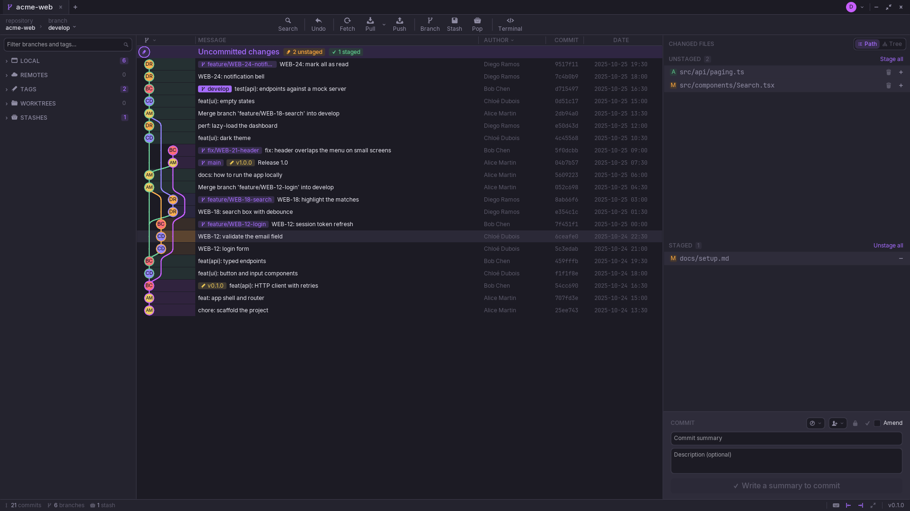

<p align="center">
  <picture>
    <source media="(prefers-color-scheme: dark)" srcset="docs/logo-on-dark.png">
    
  </picture>
</p>

<p align="center">
  <strong>A fast, native desktop Git client — written in Zig.</strong><br>
  The graph, your changes and your pull requests in one window, about 12 MB and no runtime.
</p>

<p align="center">
  
  
  
  
</p>

<p align="center">
  <picture>
    <source media="(prefers-color-scheme: light)" srcset="docs/screenshots/zit-light.png">
    
  </picture>
</p>

---

## Why Zit

- **Native and light.** One executable, drawn on the GPU. It redraws only when
  something changes, and stays around 60 MB of memory with a 4,000-commit
  repository open.
- **Everything a day of Git needs.** History, staging line by line, branches,
  rebases, conflicts, stashes, worktrees — without a terminal.
- **GitHub built in, and optional.** Pull requests, reviews, checks and issues
  next to the graph. Switch it off and Zit never talks to GitHub.
- **Your Git, untouched.** Zit runs your `git` for everything that writes, so
  hooks, credential helpers, the SSH agent and GPG signing all work as they
  already do.

## Features

<table>
<tr>
<td valign="top" width="50%">

**History**
- A graph where every commit shows its author's picture
- Search by message, `author:`, `path:`, `code:`, `after:`
- One branch, several, or all — hide any from the sidebar
- A file's history through its renames, and blame
- Compare any two commits

**Changes & commits**
- Stage files, hunks or single lines — new files too
- Discard a hunk, a file, or everything
- Ticket from the branch, conventional commits, templates
- Co-authors, sign-off, GPG or SSH signing, amend
- Undo and redo the last operation — `Ctrl+Z` / `Ctrl+Shift+Z`

**Branches**
- Create, rename, delete, switch
- Merge (fast-forward, no-ff, squash), rebase, interactive rebase
- Drag a branch onto another to merge or rebase
- Cherry-pick, revert, reset, tags

</td>
<td valign="top" width="50%">

**Remotes**
- Fetch by hand or every few minutes
- Pull by merge, rebase or fast-forward only
- Push and set the upstream; force push always with a lease
- Stashes, worktrees, Git LFS

**GitHub**
- Pull requests in full: files, commits, checks, reviews, threads
- Create, check out, review, comment, approve, merge, auto-merge
- Re-run failed checks; browse issues
- Sign in with a code on github.com

**Conflicts**
- Both sides side by side, region by region: ours, theirs, or both
- Continue, skip or abort from the banner

**Workspace**
- Tabs and tab groups, restored at start
- Command palette — `Ctrl+P`; focus mode — `Ctrl+Shift+F`
- Dark and light themes

</td>
</tr>
</table>

## Install

### Download

Get the latest build from [**Releases**](https://github.com/DamienMonchaty/zit/releases/latest):

| Platform | File |
| --- | --- |
| Windows 10 and later (x86_64) | `zit-windows-x86_64.exe` — run it, nothing to install |
| Linux (x86_64, glibc 2.31+) | `zit-linux-x86_64.tar.gz` — unpack, then `./install.sh` |

### Build from source

Zit builds from source with [Zig 0.16](https://ziglang.org/download/).
libgit2 and SDL are built along with it, so nothing else needs installing.

```sh
git clone https://github.com/DamienMonchaty/zit.git
cd zit
zig build                       # ReleaseSafe by default
./zig-out/bin/zit /path/to/a/repository
```

To make release files for every platform from one machine:

```sh
zig build dist   # zig-out/dist: Linux (.tar.gz) and Windows (.exe)
```

On Linux, the archive comes with `install.sh`, which puts Zit, its icons and
its menu entry in `~/.local` (`./install.sh --remove` takes them out again).

**At run time** Zit needs `git` on the `PATH`. `curl` is optional: it brings
the author pictures and the GitHub integration.

## GitHub

Open **Settings › GitHub** and choose **Connect GitHub**: Zit shows a code,
opens github.com, and you approve it there. Nothing else to install.

The token GitHub gives back is stored in Zit's config folder, readable by you alone, and is only
ever sent to `api.github.com`. Turning **Use GitHub** off removes pull
requests, issues and checks everywhere, and Zit sends nothing to GitHub.

## Keyboard

| Keys | Does |
| --- | --- |
| `Ctrl+P` | Command palette: any action, branch or repository |
| `Ctrl+T` / `Ctrl+W` | New tab / close tab |
| `Ctrl+F` | Search the commits |
| `Ctrl+Z` / `Ctrl+Shift+Z` | Undo / redo the last commit, checkout, merge… |
| `Ctrl+Shift+F` | Focus mode |
| `Ctrl+,` | Settings |

Every shortcut is listed in the app, under the keyboard button in the status bar.

## Under the hood

Reads go through **libgit2** — a revwalk beats parsing `git log` — and writes
go through the **`git` binary**, so they behave exactly as on the command line.
The UI is [dvui](https://github.com/david-vanderson/dvui) on SDL3.

- [How Zit is built](docs/ARCHITECTURE.md) — build options, tests, the shape of the code
- [Performance](docs/PERF.md) — how memory and CPU are measured, and what has been tried

```sh
SDL_VIDEODRIVER=dummy zig build test   # the whole suite, no display needed
```

## Privacy

Zit has no server and collects nothing: see the [privacy policy](PRIVACY.md).

## License

[MIT](LICENSE). The bundled Inter and JetBrains Mono fonts are under the
[SIL Open Font License](src/fonts/inter/OFL.txt).
