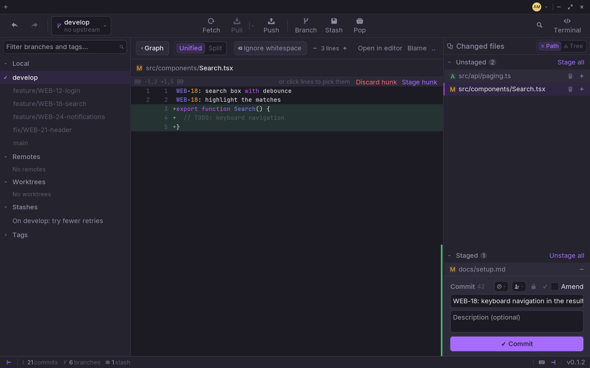

Click **Uncommitted changes** at the top of the graph, and the right-hand panel
lists what changed in your working tree.

## Stage

- **A file**: the `+` on its row, or **Stage all**. The `−` or **Unstage all**
  takes them back.
- **A hunk**: click the file to see its diff, then **Stage hunk** on the hunk.
- **Some lines**: click the lines you want in the diff, then stage them.
- **Discard**: the bin on a file's row, or **Discard hunk**.

The letter before a file says what happened to it: **A** added, **M**
modified, **D** deleted, **R** renamed.

## Write the message

The first box is the **summary**, the second the **description**.

- The summary stops at **72 characters**, as `git log` expects. Type on, and
  what does not fit goes into the description — Zit says so under the box.
- The clock brings back one of your **recent messages**.
- The person adds a **co-author**: someone from the history, as a
  `Co-authored-by` line.

In **Settings › Commit messages** you can have the **ticket** taken from the
branch's name (`WEB-18-search` puts `WEB-18` in the message), **conventional
commits** (`feat(api): …`), the description wrapped at 72 columns, a
`Signed-off-by` line, and a template.

## Commit

**Commit**, or `Ctrl+Enter`. The button says what is missing — a summary,
something staged — until it can commit.

- The **lock** signs the commit with your GPG or SSH key — see
  [Commit signing](/guides/settings/#commits).
- The **tick** adds a `Signed-off-by` line.
- **Amend** folds what is staged into the last commit, and lets you rewrite its
  message.

Everything goes through your own `git`, so your hooks run as they always do.

## Undo

Made a commit too soon? `Ctrl+Z` takes it back, its changes staged again.
`Ctrl+Shift+Z` makes it again. The same goes for a checkout, a merge, a reset.
