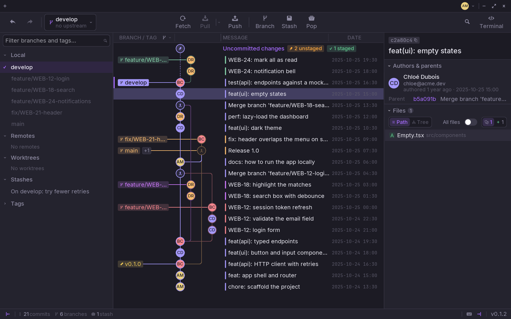
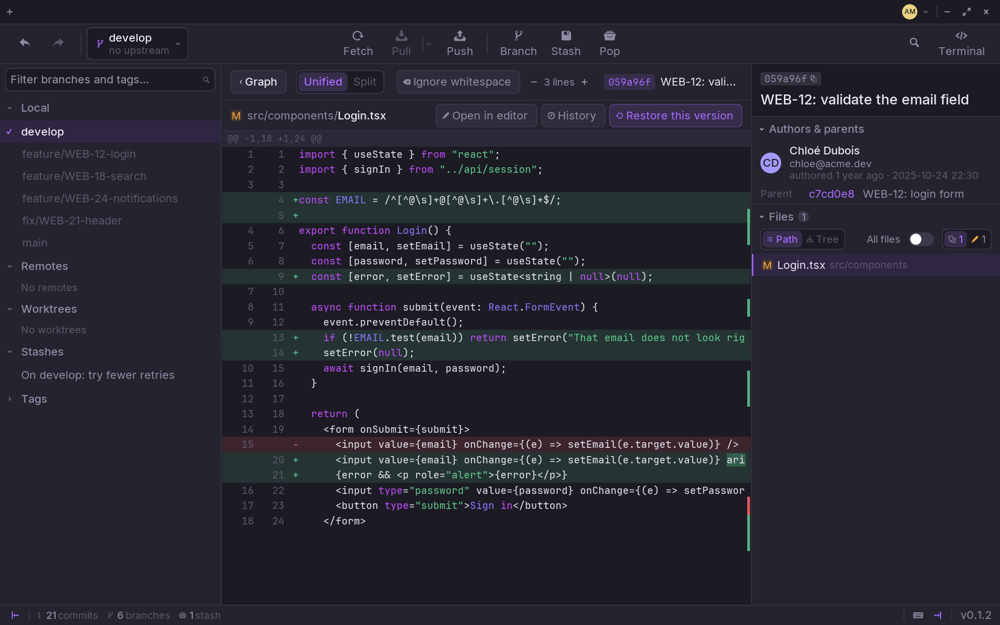

## The graph

Each line is a commit: its author's picture on the graph, its message, its
date. Branches and tags sit on the left of the commit they point to, in the
colour of their lane; `+1` says another one points there too.

- `↑` `↓` go from one commit to the next.
- The menu at the end of the **BRANCH / TAG** header shows one branch, several,
  or all of them.
- A right-click on a commit: check it out, branch or tag from it, cherry-pick,
  revert, reset, compare it with another, copy its hash.
- Rather a dot than a picture? **Settings › Appearance › Pictures in the
  graph**.

## A commit

Click a commit and the right-hand panel shows it: its hash (click to copy it),
its message, its author and committer, its parents, then its files.

- **Path** lists the files with their folder, **Tree** as folders.
- **All files** shows every file of the commit, not only the changed ones.
- The filters count the added, modified and deleted files: click one to keep
  only those.

## What changed

Click a file to see its diff in place of the graph; **Graph** takes you back.

- **Unified** or **Split**: one column, or the old and new side by side.
- **Ignore whitespace**, and how many lines of context around each change.
- **Open in editor** opens the file in your
  [external editor](/guides/settings/#general).
- **History** follows the file through its commits, renames included.
- **Blame** shows who last changed each line, and when.
- **Restore this version** puts the file back as it was in that commit.

An image shows as an image, before and after.

## Find a commit

`Ctrl+F` searches by message, author, hash, date, path or code — see
[Search the history](/guides/search/).
