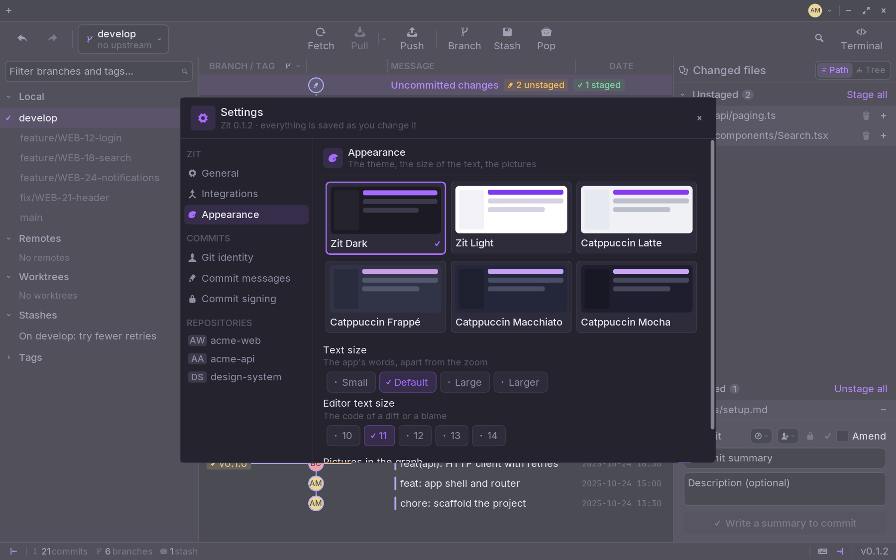
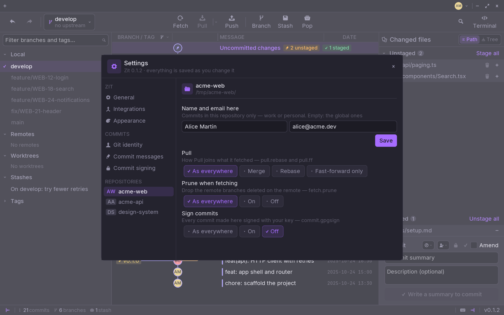

`Ctrl+,` opens the settings. Everything is saved as you change it.

## Zit

### General

- **Reopen your tabs** — start where you left off, rather than on the start
  page.
- **Default branch** — the first branch of a repository made in Zit.
- **External editor** — what a file opens with. Zit lists the editors it finds
  on your computer, or leaves it to the system.
- **Terminal** — what **Terminal** opens.
- **Fetch in the background**, every few minutes, so the counts on Pull and
  Push stay true; and **prune when fetching**.

### Integrations

**Use GitHub**, and the account Zit is connected with — see
[Connect GitHub](/start/github/). Off, Zit asks nothing of GitHub.

### Appearance

- **Theme** — Zit Dark, Zit Light, and the four Catppuccin flavours: Latte,
  Frappé, Macchiato and Mocha.
- **Text size** — the app's words, from Small to Larger, apart from the zoom.
- **Editor text size** — the code of a diff or a blame.
- **Pictures in the graph** — each commit its author's picture, or a dot.

## Commits

- **Git identity** — the name and email your commits carry, in git's global
  config.
- **Commit messages** — the ticket from the branch's name, as a prefix or a
  `Refs:` trailer; conventional commits; the description wrapped at 72
  columns; sign-off; a template.
- **Commit signing** — GPG or SSH, your signing key, and whether every commit
  and tag is signed.

## Repositories

Every repository you have opened is listed here, with its own settings, written
in its `.git/config`:

- **Name and email here** — a work address in one repository, your own
  elsewhere. Empty, the global ones apply.
- **Pull** — merge, rebase or fast-forward only.
- **Prune when fetching**.
- **Sign commits**.

**As everywhere** leaves the choice to your global Git config.
