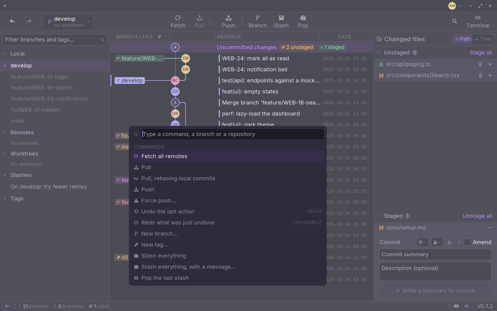

## Tabs

One repository per tab. `Ctrl+T` opens a new one, `Ctrl+W` closes it,
`Ctrl+Tab` goes to the next. `Ctrl+Shift+PgUp` and `PgDn` move a tab, and so
does dragging it.

Each repository has a badge with its initials, so you tell them apart at a
glance.

### Tab groups

Right-click a tab and put it in a **new group**: the group is a coloured dot in
front of its tabs. Add others to it from their own menu. A click on the dot
folds the group, a second one opens it again.

Your tabs and groups come back the next time Zit starts —
**Settings › General › Reopen your tabs**.

## The command palette

`Ctrl+P`, and type. Every action of Zit is there with its shortcut, and every
branch and repository too: type a branch's name to switch to it, a
repository's to open it.

## A terminal, your editor

- **Terminal** (`Ctrl+Shift+T`) opens one in the repository's folder.
- **Open in editor**, above a diff, opens the file in your editor.

Zit finds the editors and terminals installed on your computer; pick yours in
**Settings › General**.

## Zoom

`Ctrl+Plus` and `Ctrl+Minus` zoom from 70 to 200 %, `Ctrl+0` goes back to 100 %.
They work on QWERTY, AZERTY and QWERTZ keyboards alike, and the zoom is
remembered.
