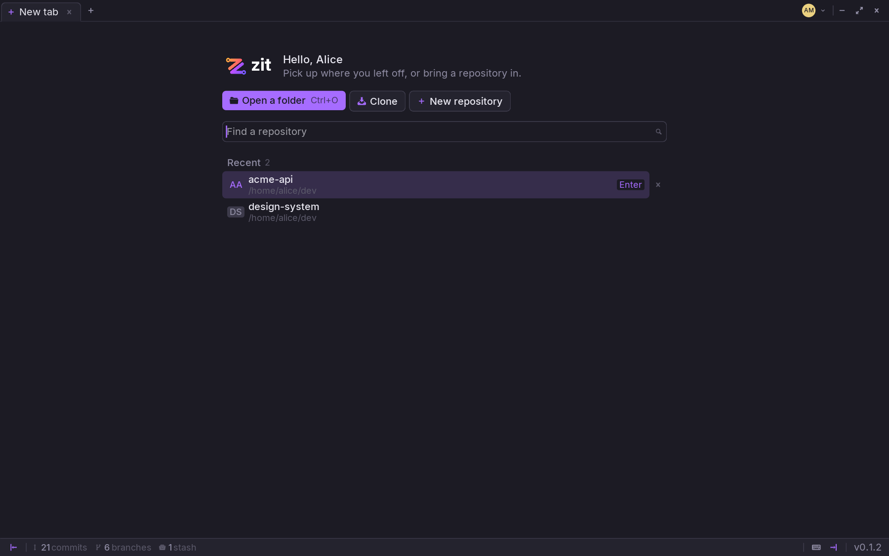
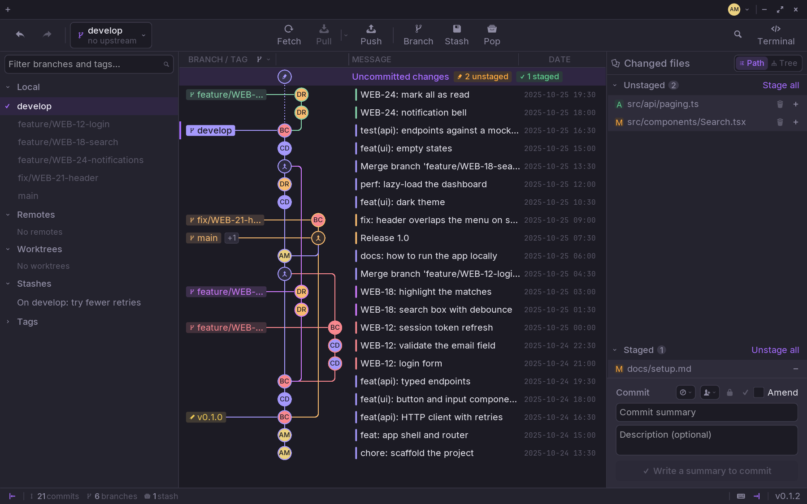

## The start page

A new tab (`Ctrl+T`) opens on the start page:

- **Open a folder** (`Ctrl+O`) — any folder inside a Git repository.
- **Clone** — a URL and where to put it.
- **New repository** — an empty one, on the default branch you chose in the
  settings.
- **Recent** — every repository a tab has held. Type to find one, `Enter` opens
  the first; the cross takes one out of the list.

The tabs you had open come back the next time Zit starts.

## The repository window

### The toolbar

- **Undo and redo**, on the left: the last commit, checkout, merge or reset,
  taken back with `Ctrl+Z`.
- **The branch you are on**, with its upstream. Click it to switch to another.
- **Fetch, Pull, Push**: the arrow next to Pull picks how it joins what it
  fetched — merge, rebase or fast-forward only. Pull and Push show how many
  commits are waiting.
- **Branch, Stash, Pop**: a new branch here, everything put aside, and the last
  stash brought back.
- **Search** (`Ctrl+F`) and **Terminal** (`Ctrl+Shift+T`), on the right.

### The branches, on the left

Local branches, remotes, worktrees, stashes and tags. Type in the filter to
find one. A click brings its commit up in the graph, a double-click checks it
out, a right-click shows everything else you can do with it. `Ctrl+B` hides the
panel.

### The graph, in the middle

Every commit with its author's picture, its branches and tags on the left of
its line. The top row, **Uncommitted changes**, is your working tree: how many
files are staged and unstaged. See [History](/guides/history/).

### The changes, on the right

What changed in your working tree, staged and unstaged, and the box to commit
it. Click a commit in the graph and this panel shows that commit instead. See
[Stage and commit](/guides/changes/). `Ctrl+J` hides it.

### The status bar

The number of commits, branches and stashes; the buttons to show or hide each
panel; the keyboard button, with [every shortcut](/guides/keyboard/); and Zit's
version.
